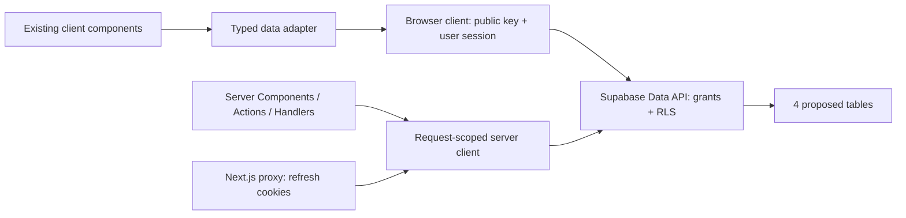

# AlmaWay V1 — Phase 2B-1: backend contract

Статус: **проект для review; не применён к Supabase**. Проверка: 11 ноября 2026.
Канонический репозиторий: `Arvex-studio/almaway-project-V1`.

## 1. Результат и границы проверки

Phase 2B-0 объединена в `main`: PR [#1](https://github.com/Arvex-studio/almaway-project-V1/pull/1),
`merged: true`, merge commit `94034e6976233c96d569b3cf9b471a24b4b4c655`.
Это SHA актуального `origin/main` после `git fetch origin main` на момент проверки.
Первоначальный локальный HEAD: `f87c6ff16f97c44ae857f6dbd5917a6195c9c716`, ветка `work`,
рабочее дерево чистое. Документы подготовлены в `docs/phase-2b-1-backend-contract`
от проверенного `origin/main`. Прочитан корневой `AGENTS.md`; других вложенных
`AGENTS.md` среди файлов репозитория не обнаружено.

При финальной ревизии повторно проверены `origin/main` (тот же SHA), чистая локальная
ветка и исходный doc commit `f383d1fd67cbc83c098eb19abd0c123daf81238e`.

**AlmaWay OAuth discovery подтверждён при повторном review PR #2.** Через разрешённое
подключение `AlmawayV1` выполнены read-only `list_projects`, `get_project`,
`get_organization`, затем попытки `list_tables(public)` и `list_migrations`.
Подключения Gridy/Qaskelen в этой ревизии не использовались.

| Metadata | Подтверждённое значение |
| --- | --- |
| Project name / ref | `almaway-project-V1` / `nwmmqtyfaumuaocspsur` |
| Organization name / id | `Almaway-project-V1` / `mlghjrgokzobvflbqmay` |
| Project status / region | `INACTIVE` / `ap-south-1` |
| Database metadata version | `17.6.1.166`, PostgreSQL 17; это metadata, не успешное соединение |
| Organization plan | `free`; наличие backups/PITR/возможность восстановления не проверены |

Имя, организация и ref совпали с переданными владельцем историческими сведениями.
Historical ref теперь подтверждён discovery metadata, однако это **не подтверждает schema**.
`list_tables` вернул `Database is possibly not accessible at the moment`;
`list_migrations` — `Connection terminated due to connection timeout`.
Ни ошибка, ни статус INACTIVE не доказывают отсутствие таблиц/migrations.
Auth, RLS и migration history остаются неизвестны; SQL и изменения состояния проекта
не выполнялись. Старый OAuth-блокер снят, повторно подключать аккаунт не требуется.

**Единственный внешний блокер для полного read-only аудита:** владельцу возобновить
существующий проект в [его Supabase Dashboard](https://supabase.com/dashboard/project/nwmmqtyfaumuaocspsur),
чтобы БД снова была доступна для чтения. Агент не выполняет Resume/Restore: это mutation,
запрещённая текущей задачей. Не создавать замену, новый проект или платные ресурсы.
После возобновления агент повторяет metadata/schema/Auth/RLS/history audit на том же ref.

| Объект проверки | Подтверждено | Не установлено |
| --- | --- | --- |
| GitHub | Canonical origin, merge 2B-0, SHA main, чистое исходное дерево | Последующие изменения main после проверки |
| Frontend | Next.js 16.3.3, React 19, TS 5.7.3; локальные данные, demo Saved/Profile | Работа с настоящими аккаунтами |
| Supabase discovery | AlmaWay project/ref/org подтверждены через AlmawayV1, статус INACTIVE | Время/способ возобновления проекта |
| Database | Попытка list_tables не смогла подключиться к БД | Таблицы, записи, расширения, функции, триггеры, views, grants, exposed schemas, RLS |
| Auth | В приложении нет Supabase/Auth-интеграции | Providers, signup, anonymous sign-ins, SMTP, redirect allowlist, JWT keys, TTL, hooks, sessions |
| Migrations | В Git нет `supabase/`, config, migrations; hosted list_migrations завершился timeout | Hosted migration history и drift |

Таблицы, migrations, Auth settings и deployment не изменялись; зависимости не добавлялись,
`package.json` и lockfile не менялись. Существующие зависимости установлены по frozen
lockfile исключительно в disposable copy для проверок, по отдельному разрешению владельца.
Причина исходного сбоя и результаты повторных проверок описаны в разделе 7.
Все схемы и архитектура далее — **предложения**, а не описание существующей БД.

Связанные результаты:

- [Минимальная схема и права](backend-schema-proposal.md).
- [Отдельный migration plan, rollback и A/B acceptance matrix](backend-migration-plan.md).
- [Самостоятельный implementation prompt Phase 2B-2](phase-2b-2-implementation-prompt.md).

## 2. Что реально использует frontend

| Потребитель | Проверенный код и поведение | Backend для V1 |
| --- | --- | --- |
| Map | `app/map/page.tsx`, `lib/tourist-places.ts`: 5 точек, локальные фильтры, selected slug, saved slugs | Опубликованный каталог; координаты с provenance; стабильные slug |
| Map boundary | `components/map/map-types.ts`: `TouristPlace[]`, `[longitude, latitude]`, `FeatureCollection<LineString>` отдельно | Adapter DB → существующие types; не передавать DB/provider types в MapSurface |
| Place Detail | `app/places/[slug]/page.tsx` ищет slug и вызывает `notFound()`; `PlaceDetails` из `lib/almaway-data.ts` | Тот же опубликованный объект, что на карте; неизвестный/draft slug → 404 |
| Detail demo | Озеро содержит `28 км`, сложность, `3–4 часа`, `8,4 км`, `420 м`; дополнительные блоки захардкожены в `components/places/place-detail.tsx` | Не импортировать эти числа как проверенные. Стоимость, сезон, транспорт, отзывы и nearby не доказаны источником координат |
| Saved | `components/demo-state.tsx`: React state, изначально сохранён slug озера; refresh сбрасывает; `app/saved/page.tsx` фильтрует локальный каталог | Приватная связь user ↔ place; пустой список нового аккаунта; сохранение между сессиями |
| Saved tabs | Только «Места» имеет данные, «Маршруты»/«Планы» показывают empty state | Не создавать routes/plans ради вкладок |
| Profile | `app/profile/page.tsx`: Алина Ким, AK, Алматы, bio и все счётчики захардкожены; настройки — DemoAction | Приватные display name, hometown, bio; initials вычисляются; saved count выводится из собственных сохранений |
| Explore | `app/explore/page.tsx`: озеро, Аюсай и Кольсай используют один `place.slug`; SaveButton также по умолчанию сохраняет озеро | Не импортировать три карточки как три достоверных объекта. Исправление привязок — отдельная задача до переключения Explore на реальные данные |
| Plan | `app/plan/page.tsx`: `useState`, фиксированный результат, нет AI/backend | Не создавать AI, plans, chat history, billing |
| Research | `data/research/`: 15 опубликованных guide estimates, без permissioned GPX | Оставить research отдельно; не seed маршрутов и не измеренные времена |

В каталоге проверены точки: `bolshoe-almatinskoe-ozero`, `medeo`, `kok-tobe`,
`butakovskiy-vodopad`, `furmanovka`. У каждой указан OSM URL и дата получения
`2026-09-30`; lake и Medeo используют bounding-box center, остальные — node.
Проверена прослеживаемость в коде, **не** актуальность координат в натуре.
Центр объекта не означает вход, начало тропы или безопасную точку доступа.

`lib/demo-route.ts` — отдельный OSM path fragment с 57 вершинами, не полный маршрут.
Не превращать его в маршрут к каждой точке и не интерполировать геометрию между местами.
Атрибуция OSM/ODbL из [map integration](map-integration.md) сохраняется.

## 3. Минимальный V1 и контракт данных

Храним четыре сущности: приватный профиль, редакционный каталог мест,
публичные источники опубликованного каталога, приватные сохранения.
Не нужны PostGIS, Realtime, Storage buckets, роли редакторов в приложении,
visits, achievements, GPS, ML predictions, reviews и persisted planner.
Позднейшая route-метрика требует отдельной идентичности route variant, единиц,
направления, временного scope и источника согласно `data/research/README.md`.

### Идентичность и публикация

- `places.id`: неизменяемый UUID для связей. `places.slug`: уникальный lower-case URL identifier;
  сохраняем пять существующих slug, после публикации не переименовываем без redirect-плана.
- `status`: `draft` или `published`; публичный клиент не читает drafts, включая detail по известному UUID.
- Публикация требует координат и authoritative coordinate source. Проверка публикации
  выполняется редакционным валидатором и атомарным admin transaction; DTO adapter
  отклоняет опубликованную запись без координатного источника. SQL FK сам по себе
  не обеспечивает наличие дочернего источника: это явная граница минимальной схемы.
- Все поля каталога и источников пригодны для публичной публикации; внутренние
  редакционные заметки, email и приватные GPS не помещаются в эти таблицы.
- `null` означает «неизвестно», а не 0. Не добавлять правдоподобные значения ради полноты UI.
- `image_url` допустим только с опубликованным image source и подтверждёнными правами;
  иначе `null`, поддерживаемый существующими компонентами. Unsplash URL сам по себе не является лицензией.

### DTO и совместимость

Это спецификация будущего adapter, **не** новый исполняемый TypeScript:

```ts
type PlaceId = string // UUID
type PlaceRecord = {
  id: PlaceId
  slug: string
  title: string
  region: string
  description: string
  why: string
  category: string // stable snake_case code, <= 64; открытая taxonomy, не union из 5 значений
  latitude: number
  longitude: number
  tags: readonly ('mountains' | 'lakes' | 'scenic' | 'weekend')[]
  image_url: string | null
  status: 'draft' | 'published'
}
// Public projection: id + categoryCode + TouristPlace + sources: SourceCitation[].
// categoryCode = row.category без потери subtype; status/timestamps не UI concerns.
// coordinates: [row.longitude, row.latitude] — никогда наоборот.
// category: ruCategoryLabel[row.category] ?? row.category; таблица mapping ниже.
// filters: mountains→Горы, lakes→Озёра, scenic→С видом, weekend→На выходные.
// Рядом = весь исходный каталог региона; Маршруты/Лёгкие = пусто до доказанных данных.
// coordinateSource: только явно выбранная primary citation coordinates/coordinates.
// Форма текущего DTO: {provider:'OpenStreetMap', url, retrievedAt:YYYY-MM-DD,
//                    method:'node'|'bounding-box-center', feature}
// metrics: []; distance: undefined; image: image_url ?? undefined.
```

### Категории и преобразование в UI

Основание исправления — [независимый review PR #2](https://github.com/Arvex-studio/almaway-project-V1/pull/2#pullrequestreview-5861744502):
20 research places, 83 sources и 12 категорий; 14 мест, включая 7 READY, не помещались
в прежний пятизначный CHECK. Эти counts — evidence из review, а не самостоятельно
пересчитанный dataset. Сам research pack с 20 cards/83 sources не найден в tracked
main/PR/workspace или доступной research ветке; в Git есть отдельные 15 duration seeds.
Не выдавать список примеров из review за полный перечень 12 категорий и не выдумывать
недостающие коды. Открытый format CHECK принимает все корректные snake_case коды,
включая все названные review, без слияния subtype или enum migration.

Планируемый adapter mapping к `TouristPlace.category: string` (RU display label):

| Сохраняемый category code | RU label |
| --- | --- |
| `lake` | Озеро |
| `lake_group` | Озёрная группа |
| `waterfall` | Водопад |
| `waterfall_group` | Группа водопадов |
| `mountain` | Гора |
| `peak` | Вершина |
| `summit` | Вершина |
| `sports_complex` | Спортивный комплекс |
| `gorge` | Ущелье |
| `canyon` | Каньон |
| `plateau` | Плато |
| `mountain_resort` | Горный курорт |
| `viewpoint_area` | Видовая зона |
| `national_park` | Национальный парк |
| Любой другой корректный код | Сам исходный код до добавления reviewed RU label |

Это mapping известных кодов, не закрытая taxonomy. Одинаковый label `peak`/`summit`
не означает изменения хранимого code. `categoryCode` сохраняется в domain DTO отдельно
от display label. Не заменять национальный парк горой, группу озёр одним озером или
курорт sports_complex; не менять slug/id ради UI normalization.

Map chips зависят **только** от reviewed `tags` (mapping приведён в DTO), не от taxonomy.
Не присваивать `mountains` всем ущельям/паркам/курортам автоматически. Существующие пять
мест сохраняют нынешние tag sets и labels; новая category без tags всё равно входит
в «Рядом», но не добавляет «Лёгкие», «Маршруты», «С видом» или «На выходные» сама по себе.
Explore сейчас не использует category enum — у него статические cards/eyebrows; при
будущем live adapter он получает тот же code/label, а editorial eyebrow не выводится
из category эвристикой. UI/chips в этом этапе не меняются.

### Source citations и совместимость singular coordinateSource

`PublicPlace.sources` хранит полный массив citations, каждая содержит `id`, `kind`,
`fieldKey`, `provider`, `sourceUrl`, `retrievedAt`, `isPrimary`, `method`, `feature`,
`attribution`, `license`. Не передавать в публичный payload внутренний import manifest
или неподтверждённые PII; published sources проходят editorial review.
Существующий `TouristPlace.coordinateSource` строится из единственного явно выбранного
primary `kind=coordinates, field_key=coordinates`, совместимого с его OSM type.
Первый элемент массива или один `.find` без primary predicate не определяет authority.
Все альтернативные sources остаются в domain DTO/API, даже если текущий UI их не рисует.

`fieldSources` импортируются как citations конкретных полей: `coordinates` →
`coordinates/coordinates`, `image_url` → `image/image_url`, `description` →
`content/description`, `category` → `content/category`. CamelCase/другие ключи сопоставляются
явной reviewed mapping table в manifest; source-поля, которых пока нет в `places`, можно
сохранить под их собственным field_key. Нельзя объединить несколько полей в одну citation
или отбросить дополнительные citations одного kind. Правила dedup, primary и конфликтов
даны в [schema proposal](backend-schema-proposal.md#несколько-источников-и-дедупликация).

Каждая исходная ссылка получает manifest mapping к citation id либо к точному duplicate
с теми же metadata. Разная attribution/license при одном dedup key — unresolved conflict,
а не успешный импорт; записи сохраняются для review. READY card не означает published,
surveyed coordinates, полный маршрут или проверенный GPS track. Исследовательский
каталог подключается позже отдельным reviewed seed и не ограничен пятью demo places.

`Рядом` сейчас не является geo-distance поиском. Не вычислять километры от произвольной
точки и не хранить геолокацию пользователя. Локальные layer/selection/filter состояния
остаются в React. Map route GeoJSON остаётся отдельным demo input.

API-independent repository boundary, планируемые операции:

| Операция | Вход | Результат / ошибки |
| --- | --- | --- |
| `listPublishedPlaces` | Без персональных параметров; весь approved V1 каталог, stable sort by slug, без LIMIT 5 | `PublicPlace[]`; только опубликованные и валидные; ошибка сети отдельно от пустого каталога |
| `getPublishedPlace` | Валидированный slug, length ≤ 100 | Тот же DTO или `not_found`; draft неотличим от missing |
| `getMyProfile` | Проверенная сессия; не user ID из клиента | Свой профиль или `null`, если ещё не инициализирован |
| `ensureMyProfile` | display_name/hometown/bio, только whitelist | INSERT своего `auth.uid()`; duplicate → перечитать, не перезаписывать существующие поля |
| `updateMyProfile` | Только display_name/hometown/bio | Своя запись; пустой UPDATE не считать успехом без проверки returned row |
| `listMySavedPlaces` | Проверенная сессия | Собственные `{placeId, savedAt, place: PublicPlace|null}[]`, newest first, затем placeId |
| `setPlaceSaved` | `{placeId, saved: boolean}` | Desired-state command; повтор безопасен; возвращает подтверждённое состояние |

Для сохранения используется INSERT с `ON CONFLICT (user_id, place_id) DO NOTHING`,
не UPSERT DO UPDATE и не read-then-toggle. Повторное удаление безопасно. В web-boundary
UUID/boolean проверяются, user ID выводится из проверенной сессии, RLS повторяет защиту.
При попытке сохранить draft/missing ответ `not_found` без раскрытия причины;
отсутствие сессии — `unauthenticated`; неверный input — `invalid_input`;
сетевой/DB сбой — `unavailable`. Raw SQL errors, JWT и ключи не отправляются в UI/логи.
Это категории результата, не обещание конкретного HTTP endpoint: V1 может использовать
Server Actions и Supabase Data API без дополнительного REST слоя.

Если место снято с публикации, saved link остаётся приватным, но joined place становится
`null` под RLS, UI пропускает карточку. Удалить своё сохранение можно даже после unpublish.
Счётчик профиля = количество **видимых опубликованных** собственных сохранений,
совпадает с отображаемыми карточками. Физическое удаление place каскадно удаляет links.

### Demo и live режимы

В Phase 2B-1 приложение полностью остаётся demo. В будущей интеграции нужен явный
конфигурационный выбор demo/live; ошибка live-запроса не заменяется незаметно demo.
Demo defaults (включая заранее сохранённое озеро) никогда не переносятся в аккаунт.
Гостевые saves могут остаться только session-only demo; нет скрытого auto-merge при login.
При sign-out/account switch очищать private state, отменять/игнорировать ответы предыдущего
пользователя. Гость получает публичный каталог, без private DB reads/writes.

Показатели «18 мест», «7 маршрутов», «126 км», achievements и статические detail-блоки
остаются demo и не записываются в БД. Пока отдельная задача не определит их честное
отображение в live UI, нельзя объявлять весь Profile/Place Detail production-ready.
Текущий этап и предложенный Phase 2B-2 оставляют UI на прежнем demo provider.

## 4. Next.js 16: предлагаемая архитектура

Проверены локальные Next guides `node_modules/next/dist/docs/01-app/` для `proxy`
и async `cookies`. В repo пока нет Supabase clients и Auth routes.



- Будущие зависимости: `@supabase/supabase-js` и `@supabase/ssr`, конкретные совместимые
  версии закрепить без `^`/`~` и обновить pnpm lockfile только в отдельно начатой реализации.
  Старые auth-helpers не нужны. Supabase пакеты в этом этапе не устанавливались.
- `lib/supabase/client.ts`: `createBrowserClient<Database>` из `@supabase/ssr`,
  browser singleton допустим в пределах одного browser context. Не хранить вторую копию
  JWT/session вручную в localStorage и не делать отдельный самописный cookie store.
- `lib/supabase/server.ts`: `server-only`, async factory на **каждый запрос**,
  `await cookies()`, `createServerClient<Database>`, `getAll`/`setAll`.
  Клиент не становится module-scope singleton и не разделяет session между пользователями.
- `proxy.ts` + `lib/supabase/proxy.ts`: refresh с `auth.getClaims()`, передать обновлённые
  cookies и в request, и в response; сохранить все SDK cookie options, Set-Cookie и cache
  headers при создании/замене response. У актуального SSR SDK `setAll` может получать
  вторым аргументом cache headers — проверить signature закреплённой версии.
- Server Components только читают cookies. Cookie writes выполняются Proxy, Server Actions
  или Route Handlers до streaming. Не маскировать произвольные ошибки `setAll`.
- На каждом private read/mutation заново проверить identity через `getClaims()`;
  `getUser()` нужен для свежего Auth user state. `getSession().user` из cookies не является
  доказательством identity. Proxy не заменяет guards в actions и RLS.
- Server client использует publishable key + session пользователя и подчиняется RLS.
  `service_role`/secret key не нужны для каталога, Profile и Saved; не добавлять их в runtime.
- Private data и ответы с session refresh: request-time rendering,
  `Cache-Control: private, no-store`, без ISR, shared `use cache` или общего CDN cache.
  Public-only каталог можно кэшировать отдельно от cookies и saved flags.
- Server Actions используют штатные same-origin/CSRF проверки Next; при собственном
  cookie-auth Route Handler нужны проверка Origin и POST/PUT/DELETE, никаких writes по GET.
  UI controls не являются авторизацией.
- Auth callback в будущей Auth-фазе: server-side PKCE code exchange,
  только allowlisted redirect paths/origins, `next` не должен разрешать внешний URL.
  Точный способ входа, email delivery и redirect allowlist сначала подтвердить в AlmaWay.
  Не включать providers и не проектировать новый login UI в Phase 2B-2.
- После sign-out очистить client caches и refresh server tree. Для чувствительных
  операций помнить: уже выданный access JWT живёт до expiry; удаление user или смена claims
  не гарантирует немедленное аннулирование JWT. Account deletion не входит в V1 API.
  `getClaims()` не проверяет server-side отзыв сессии. Если требуется более свежая проверка
  Auth user, использовать `getUser()`; строгий немедленный запрет уже выданного токена
  для прямого Data API требует отдельной revocation/session-aware RLS модели.

Планируемые env: `NEXT_PUBLIC_SUPABASE_URL`, `NEXT_PUBLIC_SUPABASE_PUBLISHABLE_KEY`.
В существующем `.env.example` есть только legacy `NEXT_PUBLIC_SUPABASE_ANON_KEY`
как placeholder; это не доказательство настройки проекта. В будущем документированно
заменить placeholder на publishable key, без реальных значений в Git. URL, ключ и
project ref должны принадлежать одному подтверждённому AlmaWay. Не поддерживать fallback
на Gridy/Qaskelen или «первый доступный» проект. Fail closed при неверной конфигурации.

## 5. Требуемый доступ к AlmaWay и следующий read-only аудит

OAuth и identity проекта уже подтверждены (раздел 1). Для полного аудита требуется
доступность БД существующего проекта после действия владельца в Dashboard; не новая
авторизация или secret в чате. При повторном запуске сначала read-only recheck статуса.
Если INACTIVE/connection errors сохраняются, не вызывать restore/resume и не переключать ref.
Для Auth config, если MCP не предоставляет его чтение, допустим read-only Dashboard
или sanitized export без SMTP/OAuth secrets/PII; такой пробел фиксируется отдельно,
а не подменяется предположением. Publishable key потребуется лишь в будущей client фазе.

После восстановления доступности ещё раз сверить ref/organization. Только затем, на этом ref:

- Read-only inventory user schemas, tables/columns/types/defaults, PK/FK/checks/indexes,
  table ownership и RLS flags; functions/triggers/views/security-invoker и exposed schemas.
- Policies из `pg_policies`, grants/default ACLs, function EXECUTE grants, роли bypass RLS;
  особенно существующие permissive policies и доступ `anon` к private данным.
- Auth config: providers, signup/anonymous mode, email confirmation/SMTP readiness,
  site URL/redirect allowlist, JWT key type/TTL, session settings/hooks; не экспортировать secrets.
- `list_migrations` и доступная `supabase_migrations.schema_migrations` metadata: версии,
  порядок, имена/checksums при наличии; сравнить с Git, проверить drift. Не читать Auth
  credentials, raw sessions, refresh tokens, password hashes и не делать SELECT * из auth.users.
- Security advisors read-only; storage/realtime/edge objects только если они влияют на
  exposed surfaces или доступ пользователей. Не включать их автоматически.

Сохранить фактический inventory отдельно с ref, временем и отметками `confirmed/unknown`.
Если часть audit capabilities недоступна, назвать конкретный пробел. Не объявлять БД
пустой/безопасной и не использовать migration repair, reset, push, apply или Auth mutations.
Metadata discovery завершён; аудит содержимого БД остановлен на двух read-only ошибках подключения.

## 6. Документационные основания

Официальные docs получены через Supabase `search_docs`; changelog — через Firecrawl.
Они описывают продукт Supabase, **не состояние AlmaWay**:

- [Next.js SSR clients](https://supabase.com/docs/guides/auth/server-side/creating-a-client),
  [SSR advanced/session caching](https://supabase.com/docs/guides/auth/server-side/advanced-guide).
- [RLS](https://supabase.com/docs/guides/database/postgres/row-level-security),
  [anonymous sign-ins](https://supabase.com/docs/guides/auth/auth-anonymous).
- [MCP setup](https://supabase.com/docs/guides/getting-started/mcp).
- [Changelog index](https://supabase.com/changelog.md),
  [CLI v3 breaking change](https://supabase.com/changelog/supabase-cli-v3): новые defaults
  выбирают local, hosted targets требуют явного выбора. В плане не фиксируются непроверенные CLI flags.
- [Explicit Data API grants](https://supabase.com/changelog/45329-breaking-change-tables-not-exposed-to-data-and-graphql-api-automatically):
  grant обязателен отдельно от RLS; существующие grants нужно аудировать, не угадывать по defaults.
- [TLS cipher change](https://supabase.com/changelog/cbc-tls-ciphers-deprecated): удаление
  устаревших CBC suites объявлено не раньше 10 ноября 2026; схема не меняется, Node/browser
  клиента проверяются отдельно. Это не подтверждает rollout на AlmaWay.

## 7. Проверка данного artifact

Финальная проверка: Node **22.23.4**, pnpm **10.34.3**, Linux, системный Chromium.
Node получен из официального `latest-v22.x`, SHA-256 архива сверена с официальным
`SHASUMS256.txt`. Инструменты установлены во временный каталог вне repo, без смены
системного Node и без добавления инструментов в зависимости приложения.

### Причина прежнего сбоя и исправление среды

Первоначальная среда имела Node 24.19.0, pnpm 11.19.0 и неполный/несогласованный
`node_modules`: не находились `maplibre-gl`, GeoJSON types и Playwright.
В установленном pnpm 11 проверен `verify-deps-before-run` default `install` и ветка
`runDepsStatusCheck`: `pnpm build` автоматически вызвал install. Тот запросил очистку
имеющегося modules directory и завершился с `ERR_PNPM_ABORTED_REMOVE_MODULES_DIR_NO_TTY`.
Изначальная прямая проверка лишь подтвердила отсутствие нужных пакетов.

В финальной ревизии владелец отдельно разрешил чистую установку. Создана disposable
копия tracked tree через `git archive` без старого `node_modules` и без ignored env files.
Установка выполнена точной версией pnpm проекта; не потребовались изменение lockfile,
ослабление frozen mode или application code fixes. Технический блокер зависимостей снят.

| Проверка | Финальный результат |
| --- | --- |
| `pnpm install --frozen-lockfile` | PASS; lockfile up to date, 93 packages, без изменения package/lockfile |
| `pnpm build` | PASS; Next.js 16.3.3 production build, все существующие routes собраны |
| `pnpm typecheck` | PASS; `tsc --noEmit` |
| `PLAYWRIGHT_CHROMIUM_EXECUTABLE_PATH=/usr/bin/chromium pnpm test` | PASS; 6 map + 1 missing-key tests, 7 ожидаемых skips при разделении конфигураций |
| Согласованность документов/frontend/Next.js | Проверены четыре документа, consumer types, Map/Detail/Saved/Profile/Explore, локальные Next guides и актуальные Supabase SSR docs |
| Security design review | Статический review RLS/ownership/grants/anon/Auth/session/A-B; результат и границы в schema proposal |
| Secret review | Ручной review четырёх документов и diff; pattern scan credentials/private keys/JWT/credential URLs, без найденных значений secrets |
| Scope/Markdown | Только четыре docs; local links и code fences проверены, `git diff --check` без ошибок |
| Supabase discovery / database audit | Discovery PASS: identity совпала; audit BLOCKED: INACTIVE, list_tables error, list_migrations timeout |
| SQL replay и runtime A/B isolation | NOT RUN: это проверка будущей реализации, текущий этап не создаёт schema/users |

Frontend checks выполнены в чистой копии исходного `f383d1f`; application source,
конфигурация, tests, package manifest и lockfile совпадают с финальной doc веткой.
Единственное автоматически изменённое tracked поле в disposable copy — `next-env.d.ts`:
Next dev переключил generated imports из `.next/types/` в `.next/dev/types/`.
Это изменение остаётся только во временной копии, не включено в PR. В основной ветке
после проверок меняются только Markdown-документы. Тесты используют контролируемый
MapTiler style и test placeholder key: это не проверка live tiles/ключа, Supabase или Auth.
Windows в текущей среде не проверялся.

В итоговом diff нет application code, dependencies, lockfile, executable migrations,
Auth configuration или deployment изменений. SQL остаётся текстом в code fences.
Документы готовы к review; Phase 2B-2 не начата. Единственное внешнее ограничение —
доступность БД существующего INACTIVE проекта для read-only audit (раздел 1).

### Повторная ревизия по замечаниям PR #2

Открытая taxonomy, UI mapping, many-source/field dedup, атрибуция и primary selection
согласованы во всех четырёх документах. Статически перепроверены RLS implications,
local links/anchors, secret patterns и doc-only diff. Полного pack replay нет без самого
20-card artifact, SQL не исполнялся; план проверки всех 12 codes/83 citations добавлен
в migration plan. Ранее успешные frontend проверки остаются применимыми: application
source, tests и package/lockfile не изменены; повторный frontend запуск из-за Markdown
правок не требуется. Изменения не реализуют Phase 2B-2.
